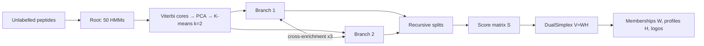

# HMM + DualSimplex: probabilistic clustering of MHC-II peptide mixtures

Code for the paper **"Clustering peptide sequences using Hidden Markov Models and matrix factorization methods"**
(A. Klimova, D. Kleverov, A. Shalyto, M. Artyomov - ITMO University / Washington University in St. Louis).

## Goal

Mass-spectrometry immunopeptidomics yields a *mixture* of peptides presented by several MHC class II molecules, with no label saying which molecule presented which peptide. Class II makes this hard: peptide length varies (12–18 aa) and binding is defined by a 9-residue core whose position is unknown.

We treat motif deconvolution as **soft clustering** in two stages:

1. **Hierarchical HMM ensemble** - a tree of interpretable HMMs is trained on the unlabelled pool; peptides are split by their inferred binding cores and the child ensembles cross-enrich each other's training sets. Every peptide is then scored against all HMMs → score matrix `S` (peptides × HMMs).
2. **DualSimplex** - factorises `V ≈ W·H` using the geometry of two linked simplices: `W` = peptide memberships, `H` = component profiles over HMMs. The number of components is read from the singular-value spectrum.



## Repository layout

```
000_make_iedb_dataset.py                 IEDB export -> curated per-allele tables
001_generate_simulated_motifs.py         synthetic mixtures with known motifs + noise
002_make_per_allele_per_length_split.py  per-allele / per-length 5-fold split (IEDB)

training_parameters.py                   ExperimentParams, *DataParams, SimpleModelClassIIParams
data_reading_methods.py                  loaders, allele mixing, length weights
peptides_utils.py                        split_to_dicts / join_dicts, logos, helpers
hmm_model_params.py                      presets of HMM architecture / pseudocounts
hmm_logic_methods.py                     model building, training, hierarchical split + enrichment
hmm_visualization_methods.py             logos, clustermaps, per-layer diagnostics
hmm_metrics.py                           reference-matrix (.mat) loading, motif metrics
motif_benchmark.py                       branch alignment + comparison with reference motifs
core_embedding_split.py                  optional: protein-LM embeddings of cores for the split

simulated_main.ipynb                     end-to-end run, simulated data
main_IEDB.ipynb                          end-to-end run, IEDB data
dual_simplex.R                           DualSimplex + comparison with GibbsCluster
```

Notebooks import the modules via `sys.path.append("../..")`; keep them together.

## Installation

**Python 3.9** (conda):

```bash
conda create -n pomegranate python=3.9 && conda activate pomegranate
pip install "numpy<1.24" pandas scipy scikit-learn matplotlib seaborn logomaker colorcet \
            umap-learn networkx tqdm mhcgnomes mhcnames "dask[dataframe]" jupyter
pip install torch==2.2.2 transformers==4.57.6 sentencepiece   # only for core_embedding_split.py
```

* pomegranate **0.14.x API** plus the custom `DiscreteDistributionAnchor` / `DiscreteDistributionCycle` classes (not in upstream - use the authors' build).
* `numpy<1.24` because of the old `np.float` alias.

**R ≥ 4.2:** `DualSimplex`, `NMF`, `hNMF` ([Genome Biol. 2026, doi:10.1186/s13059-025-03910-1](https://doi.org/10.1186/s13059-025-03910-1)), plus `dplyr tidyr stringr ggplot2 patchwork caret aricode svglite tibble`.

**Baseline:** [GibbsCluster-2.0](https://services.healthtech.dtu.dk/services/GibbsCluster-2.0/) (web or standalone).

## Simulated data

```bash
python 001_generate_simulated_motifs.py -o data/simulated_data --class II \
       --motif-count 5 --noise-level 0.25 --n-peptides 12000 --seed 42
```

12 000 peptides (12–18 aa) from 5 motifs with restrictions at P1/P4/P6/P9. With probability `--noise-level` a core is replaced by one from an unrestricted matrix. Output CSV `sim_data_motifs_5_ratio_(...)_noize_0.25.csv` (`;`-separated; columns `peptide, core, core_start, length, motif, allele, noise, binder`) + ground-truth logos. `allele`/`noise` are used for evaluation only.

Then run **`simulated_main.ipynb`** (set `root_dir` first):

1. `get_train_test_data` → `remove_unused_lengths` → writes `peptides_for_gibbscluster.txt` → length weights;
2. `prepare_multiple_models` / `train_multiple_models` - 50 root HMMs, then ranking by log-likelihood;
3. `hierarchically_train_splited_models(..., total_layers_to_do=5)`.

Each layer writes to `<result_dir>/diagnostics/dummy_allele/`: `layer{N}_scores_matrix.csv` (mean per-residue log-prob of each peptide under each HMM) and `layer{N}_clustermap_row_order.csv` (`peptide, cluster, allele, noise`).

Finish with `dual_simplex.R` on the last layer, **K = 5**, and compare with GibbsCluster run on `peptides_for_gibbscluster.txt`.

## Real data (IEDB)

1. Download `mhc_ligand_full.csv` from [IEDB](https://www.iedb.org/) into `data/`.
2. `python 000_make_iedb_dataset.py` - keeps linear peptides of canonical amino acids, removes the three assay groups inconsistent with the rest (as in Sarkizova et al.), maps qualitative labels to nominal affinities, pools with nM data, binder = ≤ 500 nM, deduplicates; writes `data#<allele>.csv` for the alleles in `ALLELES`.
3. `python 002_make_per_allele_per_length_split.py` - groups by length (8–30) and makes shuffled 5-fold splits → `<allele>#binders#{train,test}.csv`.
4. Run **`main_IEDB.ipynb`** (`PreprocessedIEDBDataParams`, lengths 12–18, `get_train_test_data(..., collapse_to_dummy=True)`). The collapse removes peptides shared between alleles, balances alleles by size preserving the length distribution, keeps the true allele as `source_allele` (evaluation only) and merges everything into one `dummy_allele`. Training is as above with `total_layers_to_do=3`.
5. `dual_simplex.R` with **K = 3**; baseline = GibbsCluster with k = 3. Reference matrices (`DRB1_0101.mat`, `DRB1_0301.mat`, `DRB1_0401.mat` in `data/reference_matrices/`) are used by `motif_benchmark` to compare recovered motifs.

> The mixture's alleles are hard-coded in data_reading_methods.py

## How the HMM ensemble is built

* **Single model:** nine emitting core states (first/last are anchors with top-*k* amino-acid restriction), two self-looping flank states, silent start/end. See `build_model_based_on_params`, presets in `hmm_model_params.py`.
* **Split:** keep the best-scoring HMMs of the node → Viterbi 9-aa core per peptide → one-hot, concatenate over models → PCA → K-means (k = 2).
* **Cross-enrichment (×3):** rescore every peptide with both child ensembles (median per-residue log-prob of the top models), move it to the better branch, retrain.
* **Stop rule:** compare child motifs by mean Jensen–Shannon distance normalised by their information content; if too similar, finalise the parent; else split the children that pass the information filter.
* **After each level:** all peptides are rescored against active and finalised ensembles and redistributed.

Main knobs: `num_runs`, `lengths_to_use`, `enrichment_steps`, `trash_model_information_threshold`, `same_model_distance_threshold`, pseudocounts. A full run takes ~2 h on a laptop CPU.

## How DualSimplex is applied (`dual_simplex.R`)

`V (N peptides × M HMMs) ≈ W (N×K) · H (K×M)`; `W` = soft memberships, `H` = component profiles over HMMs.

1. **Positive input:** `S - min(S) + 1e-8` (one global shift).
2. **Project:** `dso$project(K)`; `K` from the singular-value spectrum.
3. **Filter HMMs** with `zero_distance < 0.001`, rebuild the solver and project again.
4. **Initialise:** `set.seed(4); dso$init_solution("select_omega")`.
5. **Optimise:** `dso$optim_solution(10, optim_config(coef_hinge_H = 1, coef_hinge_W = 1, coef_der_X = 0.01, coef_der_Omega = 0.01, method = "positivity", convergence_tol = 1e-30, stop_criteria_window = 1000))`, repeated 5×; check `plot_error_history()`.
6. **Finalise:** `solution <- dso$finalize_solution()`; normalise rows of `W` to sum to 1. Peptides near a vertex belong to one component, on an edge to two, near the centre (typically noise) to none - weights flag ambiguous peptides.
7. **Export:** top-5 HMMs per component (`H_top5_models_per_component.csv`) and top-*N* peptides per component (`top_peptides.csv`, `N = 3000`) for sequence logos.

**Evaluation vs GibbsCluster:** top-*N* peptides per cluster (DualSimplex: by membership; Gibbs: by corrected score from `gibbs.<k>g.out`); confusion matrix vs true allele; greedy one-to-one cluster↔allele matching with the true noise class excluded; accuracy and macro precision/recall/F1 (`caret`); ARI, NMI, 1 − NID (`aricode`).

## Citation

> Klimova A., Kleverov D., Shalyto A., Artyomov M. *Clustering peptide sequences using Hidden Markov Models and matrix factorization methods.*

Built on: Kleverov et al., *Non-negative matrix factorization and deconvolution as a dual simplex problem*, Genome Biol. 2026, 27:25 · Kleverov, Shalyto, Artyomov, *interpretable HMMs for peptide binding regions*, Sci. Tech. J. Inf. Technol. Mech. Opt. 2023, 23(5):989–1000 · Andreatta et al., *GibbsCluster*, NAR 2017, 45(W1):W458 · Sarkizova et al., Nat. Biotechnol. 2020, 38:199.

Contacts: mus.anna.study@gmail.com · denklewer@gmail.com
