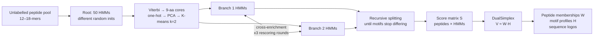

# HMM + DualSimplex: probabilistic clustering of MHC-II peptide mixtures

Code accompanying the paper **"Clustering peptide sequences using Hidden Markov Models and matrix factorization methods"**
(A. Klimova, D. Kleverov, A. Shalyto, M. Artyomov — ITMO University / Washington University in St. Louis).

---

## 1. What is this for?

In mass-spectrometry immunopeptidomics, peptides are eluted from **all** MHC class II molecules of a sample at once.
The result is a *mixture*: a pool of peptides that follow several, partly overlapping, binding motifs, and nobody tells you which molecule presented which peptide.
**Motif deconvolution** is the task of pulling that mixture apart: recovering the individual motifs and estimating how strongly each peptide belongs to each of them.

Two things make MHC-II harder than MHC-I:

* peptides have **variable length** (here 12–18 aa), and
* binding is determined by a **9-residue core** whose position inside the peptide is **unknown** (it has to be inferred together with the motif).

This repository implements a two-stage approach that treats deconvolution as **soft (probabilistic) clustering**:

| Stage | What happens | Output |
|---|---|---|
| **1. Hierarchical HMM ensemble** | A tree of interpretable hidden Markov models is trained on the unlabelled peptide pool. At every node the peptides are split in two by the alignment of their binding cores, then the two child ensembles *cross-enrich* each other's training sets. | A redundant ensemble of HMMs capturing many candidate sequence patterns, and a **peptide × HMM score matrix** `S` |
| **2. DualSimplex** | `S` is factorised as `V ≈ W·H` by the geometry of two linked simplices. | `W` (peptide × component memberships), `H` (component × HMM profiles), i.e. soft cluster assignments + motif profiles |

The number of components is read off the singular-value spectrum of the score matrix, so the method can be pointed at mixtures with an unknown number of motifs.



---

## 2. Repository layout

```
.
├── 000_make_iedb_dataset.py              # IEDB export  -> curated per-allele tables
├── 001_generate_simulated_motifs.py      # synthetic peptide mixtures with known motifs + noise
├── 002_make_per_allele_per_length_split.py   # per-allele / per-length 5-fold split of IEDB data
│
├── data_reading_methods.py               # loaders, allele collapsing ("mixing"), length weights
├── hmm_model_params.py                   # presets of HMM architecture / pseudocounts
├── hmm_logic_methods.py                  # model building, training, hierarchical splitting & enrichment
├── core_embedding_split.py               # alternative split: protein-LM embeddings (ESM-2/ProtBERT/ProtT5) of cores
│
├── simulated_main.ipynb                  # end-to-end run on simulated data (Python part)
├── main_IEDB.ipynb                       # end-to-end run on IEDB data (Python part)
└── dual_simplex.R                        # DualSimplex factorisation + comparison with GibbsCluster (R part)
```

> **Helper modules imported by the notebooks** (`training_parameters.py`, `peptides_utils.py`,
> `hmm_visualization_methods.py`, `hmm_metrics.py`, `motif_benchmark.py`) must sit next to the notebooks
> (the notebooks do `sys.path.append("../..")`). Make sure they are part of the repository.

---

## 3. Installation

The pipeline has a **Python half** (data → HMMs → score matrix) and an **R half** (score matrix → DualSimplex clusters).

### 3.1 Python (tested with Python 3.9, conda)

```bash
conda create -n pomegranate python=3.9
conda activate pomegranate

pip install "numpy<1.24" pandas scipy scikit-learn matplotlib seaborn \
            logomaker colorcet umap-learn networkx tqdm mhcgnomes mhcnames \
            dask[dataframe] jupyter
pip install torch==2.2.2 transformers==4.57.6 sentencepiece   # only for core_embedding_split.py
```

Notes:

* **pomegranate.** The code uses the legacy `HiddenMarkovModel.from_samples` / `DiscreteDistribution` API (pomegranate **0.14.x**) and additionally relies on the custom distribution classes
  `DiscreteDistributionAnchor` and `DiscreteDistributionCycle` (top-*k* amino-acid restriction with pseudocounts for anchor and flank states, see `init_distribution` in `hmm_logic_methods.py`).
  These are **not** in upstream pomegranate; install the authors' build of pomegranate that ships them.
* `numpy<1.24` is required because some helpers still use the removed `np.float` alias.
* Fonts: logos are drawn with Arial / Arial Rounded MT Bold. If these are missing, matplotlib falls back to a default font (or edit `font_name` in the plotting helpers).

### 3.2 R (≥ 4.2)

```r
install.packages(c("dplyr", "tidyr", "stringr", "ggplot2", "patchwork",
                   "caret", "aricode", "svglite", "tibble"))
# DualSimplex, NMF and hNMF — see the DualSimplex paper (Genome Biol. 2026, doi:10.1186/s13059-025-03910-1)
# for installation instructions of the DualSimplex package.
```

### 3.3 External tool for the comparison

[GibbsCluster 2.0](https://services.healthtech.dtu.dk/services/GibbsCluster-2.0/) (web server or standalone) — only needed if you want to reproduce the baseline comparison.

---

## 4. Reproducing the experiment on **simulated data**

### Step 1 — generate the mixture

```bash
python 001_generate_simulated_motifs.py \
    --output-dir data/simulated_data \
    --class-to-generate II \
    --motif-count 5 \
    --noise-level 0.25 \
    --n-peptides 12000 \
    --seed 42
```

What the generator does:

* draws **12 000 peptides of length 12–18** (class II length distribution) from **5 motifs** in equal proportions (`--ratios` to change);
* each motif is a 9-position probability matrix with restricted amino-acid sets at **P1, P4, P6 and P9**; the core start inside the peptide follows a discretised Gaussian; flanks are drawn from one shared random amino-acid distribution;
* **noise**: with probability `--noise-level` (25 %) the motif core of a peptide is replaced by a core from an unrestricted position-specific matrix (a separate noise matrix per motif class, so noisy peptides keep some class-dependent composition);
* writes a CSV (`;`-separated) named like
  `sim_data_motifs_5_ratio_(0.2, 0.2, 0.2, 0.2, 0.2)_lengths_(8,)_noize_0.25.csv`
  with columns `peptide, core, core_start, core_length, length, motif, allele (Dummy_allele_k), noise, binder`,
  plus ground-truth sequence logos in `<output-dir>/logos/`.

The `allele`/`noise` columns are **never used for training** — only for evaluation afterwards.

### Step 2 — train the hierarchical HMM ensemble

Open **`simulated_main.ipynb`** and set the paths (`root_dir`, input folder). The notebook is organised as:

| Notebook section | What it does |
|---|---|
| Read data | `ExperimentParams(data_scenario_params=SimulatedDataParams(), model_training_params=SimpleModelClassIIParams(num_runs=50))`; `get_train_test_data` loads the CSV, replicates it over the CV splits and pools everything into one `dummy_allele` |
| Prepare data | `remove_unused_lengths` (keeps 12–18), **writes `peptides_for_gibbscluster.txt`** (the unique peptides, one per line — the input for the baseline), `calculate_weights_based_on_length_counts` |
| Models | `prepare_multiple_models` → `train_multiple_models` (**50 HMMs from different random initialisations**, Baum–Welch with pseudocounts) → `reorder_models_by_score_and_flatten_to_by_name_list` (ranking by final training log-likelihood) |
| Splitting | `hierarchically_train_splited_models(..., total_layers_to_do=5)` — the recursive split + enrichment described in §6 |
| (optional) baselines | K-means, agglomerative and spectral clustering directly on the score matrix (`run_all`), with silhouette-based choice of *k* |

After every layer of the tree, the diagnostics folder
`<result_dir>/diagnostics/dummy_allele/` receives:

* `layer{N}_scores_matrix.csv` — **the peptide × HMM score matrix** (mean per-residue log-probability of the peptide under each HMM);
* `layer{N}_clustermap_row_order.csv` — row annotation (`peptide`, current cluster, `allele` = true label, `noise`);
* clustermaps / UMAPs (`*.svg`, Russian and English labels).

Trained models are stored per branch (`br1`, `br11`, `br12`, …) as `model.json` + `history.csv`.

### Step 3 — DualSimplex

Run `dual_simplex.R` (see §7 for what each block does). Point it to the `layer{N}_scores_matrix.csv` / `layer{N}_clustermap_row_order.csv` of the **last** layer and set the number of components to **5** (`dso$project(5)`).

### Step 4 — baseline and metrics

1. Upload `peptides_for_gibbscluster.txt` to GibbsCluster-2.0 and run it for several numbers of clusters (the KLD criterion of the tool picks the "best" one; the paper compares at the true *k* as well).
2. Put the resulting `gibbs.*g.out` into the path expected by the R script — the last part of `dual_simplex.R` ranks peptides by corrected score, builds confusion matrices for both methods and computes the metrics (§7.4).

---

## 5. Reproducing the experiment on **real data (IEDB)**

### Step 0 — get the IEDB export

Download the full MHC ligand table from the [Immune Epitope Database](https://www.iedb.org/) (`mhc_ligand_full.csv`, CSV export with the two-row header) and put it in `data/`.

### Step 1 — curate IEDB: `000_make_iedb_dataset.py`

```bash
python 000_make_iedb_dataset.py      # edit DATA_PATH_BASE at the top first
```

This script:

1. reads only the needed columns of the two-row-header IEDB table (chunked, the file is large);
2. keeps **linear peptides** made exclusively of the 20 canonical amino acids (no PTMs, no `X/B/Z`);
3. drops the three assay groups that are inconsistent with the rest, following Sarkizova et al. (EC50 purified-MHC/fluorescence, KD purified-MHC/radioactivity, EC50 cellular-MHC/fluorescence);
4. converts qualitative annotations to nominal affinities (`Positive-High` 100 nM, `Positive-Intermediate` 1000 nM, `Positive-Low` 5000 nM, `Positive` 500 nM, `Negative` 5000 nM) and pools them with the quantitative nM measurements;
5. labels **binders = affinity ≤ 500 nM**, collapses duplicate records;
6. writes one file per allele: `data/simple_model_enrichment/data#<allele>.csv` (the alleles to export are set in the `ALLELES` list; allele names are normalised with `mhcgnomes`).

### Step 2 — per-allele / per-length cross-validation split: `002_make_per_allele_per_length_split.py`

```bash
python 002_make_per_allele_per_length_split.py
```

Peptides of 8–30 aa are grouped **by length**, and within each length split by shuffled **5-fold** cross-validation (lengths with ≤ 5 peptides are skipped).
Output: `data/simple_model_enrichment/per_length_per_kfold_split/<allele>#binders#{train,test}.csv` with columns `peptide; length; split`.
(The script also draws length histograms and sequence logos as sanity checks.)

### Step 3 — build the "mixture" and run the pipeline: `main_IEDB.ipynb`

```python
hmm_params = ExperimentParams(
    root_dir=...,
    data_scenario_params=PreprocessedIEDBDataParams(),
    model_training_params=SimpleModelClassIIParams(num_runs=50, lengths_to_use=[12,13,14,15,16,17,18]),
)
... = get_train_test_data(hmm_params, collapse_to_dummy=True)
```

`collapse_to_dummy=True` is what turns individual alleles into an **unlabelled mixture** (`data_reading_methods.py`):

1. peptides that occur in more than one allele are removed (ambiguous ground truth);
2. alleles are **balanced** to the same size, preserving the pooled length distribution;
3. the true allele is kept as `source_allele` (evaluation only), then all alleles are merged into one `dummy_allele`.

> ⚠️ **Choose the alleles of the mixture in `get_train_test_data`.**
> The set of alleles kept is currently hard-coded in the `PreprocessedIEDBDataParams` branch:
> ```python
> # KEEP = {"HLA-DRB1_0101", "HLA-DRB1_0301", "HLA-DRB1_0401"}   # 3-allele DRB1 mixture
> KEEP = {"HLA-DPA1_0202-DPB1_0501"}                              # single DP heterodimer (submotif analysis)
> ```
> Un-comment the line you need. The three-allele DRB1 mixture (HLA-DRB1\*01:01, \*03:01, \*04:01) is the multi-allele experiment; the single DP heterodimer HLA-DPA1\*02:02/DPB1\*05:01 is the experiment about **sub-motifs inside one allele**.

The rest of the notebook follows the same recipe as the simulated one (50 root HMMs → `hierarchically_train_splited_models(total_layers_to_do=3)` → export of `layer{N}_scores_matrix.csv`), followed by DualSimplex with **3** components for the DRB1 mixture.

For the benchmark against known motifs, the notebook loads reference position-specific 9 × 20 matrices (`DRB1_0101.mat`, `DRB1_0301.mat`, `DRB1_0401.mat` in `data/reference_matrices/`) and compares each recovered branch with them (`motif_benchmark.benchmark_motifs`: KL divergence against the amino-acid background and Pearson correlation of the matrices).

### Step 4 — baseline

Same as for simulated data: feed `IEDB_peptides_for_gibbscluster.txt` (written by the notebook) to GibbsCluster-2.0 with `k = 3`, and compare with the DualSimplex clusters using the R script.

---

## 6. How the hierarchical HMM ensemble works

**Single model** (architecture from Kleverov et al., *interpretable HMMs for peptide binding*): a linear nine-state emitting **core** (first and last core positions are *anchors*), two **flank** states with self-loops (absorb the variable N-/C-terminal lengths), and silent start/end states. Only the anchor positions are explicitly restricted (top-*k* amino acids with pseudocounts); the motif at the inner positions is learned freely. Presets are in `hmm_model_params.py`, the graph is built in `build_model_based_on_params`.

**Tree construction** (`hierarchically_train_splited_models` → `make_single_split_and_enrich`):

1. **Root (`br1`).** Train an ensemble of 50 HMMs on the whole pool; each run starts from a different random initialisation. Peptide-level weights compensate for the length distribution.
2. **Split.** Rank the HMMs by training log-likelihood and keep the best ones. For every peptide, the **Viterbi** path under each retained HMM gives a 9-residue core; the cores are one-hot encoded and concatenated over models → **PCA** (variance threshold, ≤ 30 components) → **K-means, k = 2** (fitted on split 0, applied to the others). This yields two disjoint child peptide sets.
3. **Child ensembles.** Train a fresh ensemble of HMMs on each child set.
4. **Cross-enrichment (×3).** Rescore *every* peptide of the parent node with both child ensembles (median of per-residue log-probability over the top models), re-assign it to the better-scoring branch, retrain both ensembles. A peptide can therefore migrate to the neighbouring branch if that branch explains it better.
5. **Stop or recurse.** Average the position-specific distributions of each child's best models, compute their *information content* and the *Jensen–Shannon distance* between the two child motifs (normalised by twice the sum of the information contents). If the children are too similar, the split is rejected and the parent ensemble is finalised; otherwise only the children that pass the information-content filter are split further.
6. **Level-wise reshuffling.** After a whole level is done, all peptides are rescored against all active and finalised ensembles; each goes to the training set of the best-scoring active branch (or is frozen if a finalised ensemble wins).
7. The procedure ends when no suitable branches remain or `total_layers_to_do` is reached. All retained HMMs form the **final ensemble**, and every peptide is scored against it to get the matrix `S`.

Key knobs (in `ModelTrainingParams` / `SimpleModelClassIIParams`): `num_runs`, `lengths_to_use`, `enrichment_steps`, `reassignment_decision_models_fraction`, `enrichment_split_decision_models_fraction`, `statistics_estimate_model_fraction`, `trash_model_information_threshold`, `same_model_distance_threshold`, and the pseudocounts (`emission_pseudocount`, `transition_pseudocount`, `anchor_top_aas`, …).

`core_embedding_split.py` contains an alternative first-level split in which the extracted cores are embedded with a protein language model (ESM-2, ProtBERT or ProtT5) before PCA + K-means. It is not required for the main pipeline.

Runtime: a full simulated or IEDB run takes on the order of **2 hours on a laptop CPU** (the models are independent, so training parallelises naturally).

---

## 7. How DualSimplex is applied (`dual_simplex.R`)

[DualSimplex](https://doi.org/10.1186/s13059-025-03910-1) (Kleverov et al.) is a non-negative matrix factorisation / deconvolution method. After a Sinkhorn-type normalisation, rows and columns of the data live in a low-dimensional space where both the observations and the features sit inside **two linked simplices**; the factors are read off the vertices of those simplices. Applied here:

```
V  (N peptides × M HMMs)  ≈  W (N × K)  ·  H (K × M)
```

* `W` — **peptide memberships** per component (soft clustering),
* `H` — **component profiles**: how each component scores across the HMM ensemble (which HMMs "define" which motif).

### 7.1 Input

`S` = `layer{N}_scores_matrix.csv`. DualSimplex needs a strictly positive matrix, so a single **global shift** is applied (differences between scores are preserved):

```r
scores_matrix <- scores_matrix - min(scores_matrix) + 1e-8
```

The second file (`..._clustermap_row_order.csv`) carries the ground truth (`allele`, `noise`) and is used **only for colouring the plots and for evaluation**, never for fitting. Noise peptides get their own `noise` class.

### 7.2 Factorisation

```r
dso <- DualSimplexSolver$new()
dso$set_data(as.matrix(scores_matrix))
dso$project(K)                 # SVD/Sinkhorn projection to K dims; K from the singular-value spectrum
dso$run_umap()                 # visual check of the projected data
```

1. **Projection.** `project(K)` embeds peptides and HMMs in a `K-1`-dimensional simplex space. Choose `K` by looking at the singular-value spectrum (the elbow) — in the experiments **K = 5** for the simulated mixture and **K = 3** for the IEDB DRB1 mixture.
2. **Remove uninformative HMMs.** Columns (HMMs) whose `zero_distance` is below `0.001` are dropped and the solver is re-created on the filtered matrix:
   ```r
   col_anno <- DualSimplex::get_anno(dso$st$data, genes = FALSE)
   keep     <- which(col_anno$zero_distance >= 0.001)
   dso      <- DualSimplexSolver$new(); dso$set_data(dso_old$st$data[, rownames(col_anno)[keep]])
   dso$project(K)
   ```
3. **Initialisation.** `set.seed(4); dso$init_solution("select_omega")` picks starting simplex vertices from the data.
4. **Optimisation.** The vertices are refined by gradient steps (5 × 10 iterations in the script):
   ```r
   dso$optim_solution(10, config = optim_config(
       coef_hinge_H = 1, coef_hinge_W = 1,            # penalties for negative entries of H and W
       coef_der_X = 0.01, coef_der_Omega = 0.01,      # regularisation of the simplex vertices
       method = "positivity",
       convergence_tol = 1e-30, stop_criteria_window = 1000))
   dso$plot_error_history()
   ```
5. **Finalise.** `solution <- dso$finalize_solution()` gives `W` and `H`. Rows of `W` are normalised to sum to 1 → soft memberships:
   ```r
   peptide_to_components <- as.data.frame(solution$W)
   peptide_to_components <- peptide_to_components / rowSums(peptide_to_components)
   ```
   Peptides near a simplex vertex belong to one component; peptides on an edge are shared between two; peptides near the centre (typically noise) have no dominant component — the weights therefore also flag **ambiguous assignments**.

### 7.3 Outputs

* `H_top5_models_per_component.csv` — the 5 highest-weight HMMs of every component (traceable back to the HMM, its branch and its motif);
* `top_peptides.csv` — top-*N* peptides per component by normalised membership (`N <- 3000` in the script; these peptides are what the sequence logos are built from);
* UMAP / simplex plots coloured by true cluster and by `zero_distance`, `plane_distance`.

### 7.4 Evaluation against GibbsCluster

For both methods the top-*N* peptides per cluster are taken (DualSimplex: by normalised membership; GibbsCluster: by corrected score; parse `gibbs.<k>g.out`, columns peptide / group / score / corrected score).

* confusion matrix: predicted cluster × true allele;
* clusters are matched to alleles **greedily and one-to-one** (largest count first, each cluster and each allele used once); the true `noise` class is excluded;
* classification metrics after matching: accuracy and macro-averaged precision / recall / F1 (`caret::confusionMatrix`);
* label-agnostic clustering metrics: **ARI**, **NMI** and **1 − NID** (`aricode`);
* per-cluster precision / recall / F1 box plots, and a combined figure `clustering_performance_comparison.svg`.

---

## 8. Practical notes

* **Paths are hard-coded** (`/Users/annaklimova/...`) in the scripts, notebooks and the R file. Search for `Users/annaklimova`, `root_dir` and `DATA_PATH_BASE` and change them to your own.
* The R script contains some Russian plot labels (`Кластер`, `Аллель`, `Шум`); the metric functions take the noise label as an argument (`"noise"` or `"Шум"`), keep it consistent with the labels you actually have.
* Random seeds: the data generator takes `--seed`; the DualSimplex initialisation uses `set.seed(4)`; the HMM ensembles are initialised randomly on purpose (that diversity is what the ensemble is for), so exact trees differ between runs.
* Intermediate state of long runs is written to disk after every layer (models in `<result_dir>/<branch>/`, matrices in `<result_dir>/diagnostics/`), so DualSimplex can be re-run without retraining.

---

## 9. Citation

If you use this code, please cite:

> Klimova A., Kleverov D., Shalyto A., Artyomov M. *Clustering peptide sequences using Hidden Markov Models and matrix factorization methods.*

and the methods it builds on:

* Kleverov D., Aladyeva E., Serdyukov A., Artyomov M.N. *Non-negative matrix factorization and deconvolution as a dual simplex problem.* Genome Biology, 2026, 27(1):25. doi:10.1186/s13059-025-03910-1
* Kleverov D.A., Shalyto A.A., Artyomov M. *A method for constructing interpretable hidden Markov models for finding peptide binding regions in protein sequences.* Scientific and Technical Journal of Information Technologies, Mechanics and Optics, 2023, 23(5):989–1000. doi:10.17586/2226-1494-2023-23-5-989-1000
* Andreatta M., Alvarez B., Nielsen M. *GibbsCluster: unsupervised clustering and alignment of peptide sequences.* Nucleic Acids Research, 2017, 45(W1):W458–W463. doi:10.1093/nar/gkx248
* Sarkizova S. et al. *A large peptidome dataset improves HLA class I epitope prediction across most of the human population.* Nature Biotechnology, 2020, 38(2):199–209. (assay filtering and binder definition)

## 10. Contacts

Anna Klimova — mus.anna.study@gmail.com · Denis Kleverov — denklewer@gmail.com
